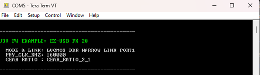
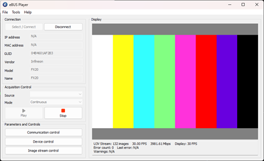

# EZ-USB&trade; FX20: USB3 Vision (U3V) 4K camera application

This application implements a USB3 Vision device camera, streaming image data using Infineon's EZ-USB&trade; FX20 device. The code example is a part of application note [AN241977](https://www.infineon.com/products/universal-serial-bus/usb-3-2-peripheral-controllers/ez-usb-fx20-usb-20-gbps-peripheral-controller#documents).

> **Improtant Note:** AN241977 access requires "log in" in to the *myinfineon* website. The *AN241977: Implementing a USB3 Vision device using EZ-USB&trade; FX20/FX10/FX5N/FX5* application note is available under [FX20 Documents](https://www.infineon.com/products/universal-serial-bus/usb-3-2-peripheral-controllers/ez-usb-fx20-usb-20-gbps-peripheral-controller#documents) section.

A base version of U3V device implemenation example is available on git: [EZ-USB&trade; FX20: USB3 Vision (U3V) application](https://github.com/Infineon/mtb-example-fx20-usb3vision).

Base version of the EZ-USB&trade; FX20: USB3 Vision (U3V) application firmware example has the following streaming options:

- Internal color bar (RAM-based)
- Internal color bar (Internal loop back)
- FPGA generated color bar

The EZ-USB&trade; FX20: USB3 Vision (U3V) 4K camera application note firmware example does **NOT** support **FX internal generated color bar**; it has the following features:

#### EZ-USB&trade; FX20: USB3 Vision (U3V) 4K camera application firmware features

- Supports streaming using the [VC MIPI IMX415C](https://www.mipi-modules.com/fileadmin/external/documentation/hardware/VC_MIPI_Camera_Module/index.html) 4K camera

- Supports streaming using THine [THSCG101](https://www.thinesolutions.com/kit-solutions/thscg101) 4K Camera

- Supports streaming using FPGA-generated colorbar up to 4K 120 fps (*require relavent fpga binary*)

- **U3V-specific feature:** software trigger, single/conituous/multi-frame modes, timestamp and frame id chunk data (only in LVCMOS DDR WideLink configuration, limitaion at fpga binary)

> **Note:** This code example is an alpha release for the EZ-USB&trade; FX20 device, and is also applicable to EZ-USB&trade; FX10, FX5N, and FX5 devices.

[View this README on GitHub.](https://github.com/Infineon/mtb-example-fx20-usb3vision-4k-camera)

[Provide feedback on this code example.](https://yourvoice.infineon.com/jfe/form/SV_1NTns53sK2yiljn?Q_EED=eyJVbmlxdWUgRG9jIElkIjoiQ0UyNDIwNjkiLCJTcGVjIE51bWJlciI6IjAwMi00MjA2OSIsIkRvYyBUaXRsZSI6IkVaLVVTQiZ0cmFkZTsgRlgyMDogVVNCMyBWaXNpb24gKFUzVikgNEsgY2FtZXJhIGFwcGxpY2F0aW9uIiwicmlkIjoiYW5raXQua3VtYXIyQGluZmluZW9uLmNvbSIsIkRvYyB2ZXJzaW9uIjoiMS4wLjAiLCJEb2MgTGFuZ3VhZ2UiOiJFbmdsaXNoIiwiRG9jIERpdmlzaW9uIjoiTUNEIiwiRG9jIEJVIjoiV0lSRUQiLCJEb2MgRmFtaWx5IjoiU1NfVVNCIn0=)


## Requirements

- [ModusToolbox&trade;](https://www.infineon.com/modustoolbox) v3.5 or later (tested with v3.5)
- Board support package (BSP) minimum required version: 4.3.3
- Programming language: C
- Associated parts: [EZ-USB&trade; FX20](https://www.infineon.com/fx20)


## Supported toolchains (make variable `TOOLCHAIN`)

- GNU Arm&reg; Embedded Compiler v11.3.1 (`GCC_ARM`) – Default value of `TOOLCHAIN`


## Supported kits (make variable `TARGET`)

- [EZ-USB&trade; FX20 DVK Kit](https://www.infineon.com/evaluation-board/KIT-FX20-FMC-001) (`KIT_FX20_FMC_001`)
- [EZ-USB&trade; FX20 Demo Board](https://www.infineon.com/evaluation-board/DEMO-FX20-MIPI-001) (`DEMO_FX20_MIPI_KIT`)

> **Note:** Current firmware supports both hardware kits using same `TARGET` make variable (`KIT_FX20_FMC_001`)


## Hardware setup

This example uses the two hardware boards: [KIT_FX20_FMC_001](https://www.infineon.com/evaluation-board/KIT-FX20-FMC-001) and [DEMO_FX20_MIPI_KIT](https://www.infineon.com/evaluation-board/DEMO-FX20-MIPI-001). This example demonstrates the implementation of a U3V compliant camera application explained in application note: [AN241977](https://www.infineon.com/products/universal-serial-bus/usb-3-2-peripheral-controllers/ez-usb-fx20-usb-20-gbps-peripheral-controller#documents)

> **Note:** The Ti180 FPGA BitFiles listed in **Table 7 and Table 8** (see the [FPGA BitFile information](#fpga-bitfile-information) Section) supports up to 4K (3840 x 2160) colorbar and image sensor video streaming.


## Software setup

See the [ModusToolbox&trade; tools package installation guide](https://www.infineon.com/ModusToolboxInstallguide) for information about installing and configuring the tools package.

Install a terminal emulator if you do not have one. Instructions in this document use [Tera Term](https://teratermproject.github.io/index-en.html).

Install a USB3 Vision host application such as [eBUS Player](https://www.pleora.com/machine-vision-connectivity/ebus-player) or [Aravis](https://community.infineon.com/t5/Knowledge-Base-Articles/EZ-USB-FX3-DEMO-FX3-U3V-CAM01-Camera-Kit-U3V-Video-Streaming-with-Aravis-Player/ta-p/726813) to view the video stream.


## Using the code example


### Create the project

The ModusToolbox&trade; tools package provides the Project Creator as both a GUI tool and a command line tool.

<details><summary><b>Use Project Creator GUI</b></summary>

1. Open the Project Creator GUI tool

   There are several ways to do this, including launching it from the dashboard or from inside the Eclipse IDE. For more details, see the [Project Creator user guide](https://www.infineon.com/ModusToolboxProjectCreator) (locally available at *{ModusToolbox&trade; install directory}/tools_{version}/project-creator/docs/project-creator.pdf*)

2. On the **Choose Board Support Package (BSP)** page, select a kit supported by this code example. See [Supported kits](#supported-kits-make-variable-target)

   > **Note:** To use this code example for a kit not listed here, you may need to update the source files. If the kit does not have the required resources, the application may not work

3. On the **Select Application** page:

   a. Select the **Applications(s) Root Path** and the **Target IDE**

      > **Note:** Depending on how you open the Project Creator tool, these fields may be pre-selected for you

   b. Select this code example from the list by enabling its check box

      > **Note:** You can narrow the list of displayed examples by typing in the filter box

   c. (Optional) Change the suggested **New Application Name** and **New BSP Name**

   d. Click **Create** to complete the application creation process

</details>


<details><summary><b>Use Project Creator CLI</b></summary>

The `project-creator-cli` tool can be used to create applications from a CLI terminal or from within batch files or shell scripts. This tool is available in the *{ModusToolbox&trade; install directory}/tools_{version}/project-creator/* directory.

Use a CLI terminal to invoke the `project-creator-cli` tool. On Windows, use the command-line `modus-shell` program provided in the ModusToolbox&trade; installation instead of a standard Windows command-line application. This shell provides access to all ModusToolbox&trade; tools. You can access it by typing "modus-shell" in the search box in the Windows menu. In Linux and macOS, you can use any terminal application.

The following example clones the "[FX20 USB3 Vision (U3V) 4k Camera](https://github.com/Infineon/mtb-example-fx20-usb3vision-4k-camera)" example with the desired name "USB3V_4k_Camera" configured for the *KIT_FX20_FMC_001* BSP into the specified working directory, *C:/mtb_projects*:

   ```
   project-creator-cli --board-id KIT_FX20_FMC_001 --app-id mtb-example-fx20-usb3vision-4k-camera --user-app-name USB3V_4k_Camera --target-dir "C:/mtb_projects"
   ```

The `project-creator-cli` tool has the following arguments:

Argument | Description | Required/optional
---------|-------------|-----------
`--board-id` | Defined in the <id> field of the [BSP](https://github.com/Infineon?q=bsp-manifest&type=&language=&sort=) manifest | Required
`--app-id`   | Defined in the <id> field of the [CE](https://github.com/Infineon?q=ce-manifest&type=&language=&sort=) manifest | Required
`--target-dir`| Specify the directory in which the application is to be created if you prefer not to use the default current working directory | Optional
`--user-app-name`| Specify the name of the application if you prefer to have a name other than the example's default name | Optional

<br>

> **Note:** The project-creator-cli tool uses the `git clone` and `make getlibs` commands to fetch the repository and import the required libraries. For details, see the "Project creator tools" section of the [ModusToolbox&trade; tools package user guide](https://www.infineon.com/ModusToolboxUserGuide) (locally available at {ModusToolbox&trade; install directory}/docs_{version}/mtb_user_guide.pdf).

</details>


### Open the project

After the project has been created, you can open it in your preferred development environment.


<details><summary><b>Eclipse IDE</b></summary>

If you opened the Project Creator tool from the included Eclipse IDE, the project will open in Eclipse automatically.

For more details, see the [Eclipse IDE for ModusToolbox&trade; user guide](https://www.infineon.com/MTBEclipseIDEUserGuide) (locally available at *{ModusToolbox&trade; install directory}/docs_{version}/mt_ide_user_guide.pdf*).

</details>


<details><summary><b>Visual Studio (VS) Code</b></summary>

Launch VS Code manually, and then open the generated *{project-name}.code-workspace* file located in the project directory.

For more details, see the [Visual Studio Code for ModusToolbox&trade; user guide](https://www.infineon.com/MTBVSCodeUserGuide) (locally available at *{ModusToolbox&trade; install directory}/docs_{version}/mt_vscode_user_guide.pdf*).

</details>


<details><summary><b>Command line</b></summary>

If you prefer to use the CLI, open the appropriate terminal, and navigate to the project directory. On Windows, use the command-line `modus-shell` program; on Linux and macOS, you can use any terminal application. From there, you can run various `make` commands.

For more details, see the [ModusToolbox&trade; tools package user guide](https://www.infineon.com/ModusToolboxUserGuide) (locally available at *{ModusToolbox&trade; install directory}/docs_{version}/mtb_user_guide.pdf*).

</details>


### Using this code example with specific products

By default, the code example build is targeted for the CYUSB4024-BZXI product, which has 512 KB of flash memory and 1024 KB of buffer RAM. Use the **BSP Assistant** tool to modify the application to target different EZ-USB&trade; FX20, EZ-USB&trade; FX10, EZ-USB&trade; FX5N, or EZ-USB&trade; FX5 family products, as shown in **Table 1**.

> **Note:** This application utilizes the Quad SPI interface on the EZ-USB&trade; FX device and hence is not supported on CYUSB4022-FCAXI, CYUSB4012-FCAXI, CYUSB3282-FCAXI, and CYUSB3082-FCAXI devices. It also requires more than 512 KB of DMA buffer RAM and hence is not supported on the CYUSB3081-FCAXI device.

**Table 1. Products supported by this code example**

Product           | Family | Flash size (KB) | Buffer RAM size (KB)
:---------------- | :----- | :-------------- | :-------------------
CYUSB4024-BZXI    | FX20   | 512             | 1024
CYUSB4021-FCAXI   | FX20   | 512             | 1024
CYUSB4014-FCAXI   | FX10   | 512             | 1024
CYUSB4013-FCAXI   | FX10   | 512             | 1024
CYUSB4011-FCAXI   | FX10   | 512             | 1024
CYUSB3284-FCAXI   | FX5N   | 512             | 1024
CYUSB3084-FCAXI   | FX5    | 512             | 1024
CYUSB3083-FCAXI   | FX5    | 512             | 1024
<br>

#### Setup for a different product

Perform the following steps to modify the code example to work on a different product, as listed in **Table 1**:

1. Launch the BSP Assistant tool:

   a. **Eclipse IDE:** Launch the BSP Assistant tool by navigating to **Quick Panel** > **Tools**

   b. **Visual Studio Code:** Select the ModusToolbox&trade; extension from the left menu bar and launch the BSP Assistant tool, which is available in the **Application** menu of the **MODUSTOOLBOX TOOLS** section

2. In **BSP Assistant**, select **Devices** from the tree view on the left

3. Choose the desired part from the dropdown menu on the right

4. Click **Save** to close the BSP Assistant tool

5. Build the application and proceed with programming


## Operation

> **Note:** If the target hardware is FX20 DVK, it requires Ti180 DVK programming using the Efinix programming tool.


### Program Ti180 DVK

1. Browse the *\<CE Title>/BitFile/* folder for the Ti180 FPGA binary and locate the _*.hex_ file and program the FPGA. For more details, see the [Ti180J484 kit user guide](https://www.efinixinc.com/products-devkits-titaniumti180j484.html)

2. After successful programming, switch off the FPGA DVK power, connect the FPGA (Titanium Ti180 J484) DVK to the FMC (J8) connector of the KIT_FX20_FMC_001 board and switch on the FPGA DVK power

> **Note:** Make hardware modifications as described in the application note [AN241977](https://www.infineon.com/products/universal-serial-bus/usb-3-2-peripheral-controllers/ez-usb-fx20-usb-20-gbps-peripheral-controller#documents).


### Program EZ-USB&trade; FX20 (Same for both hardware kits) and on-board external flash for Ti180 FPGA (DEMO_FX20_MIPI_KIT_001)

1. Connect the target hardware board (J2) to your PC using the provided USB cable. Connect the USB FS port (J3) on the board to the PC for debug logs

2. Perform the following steps to program the board using the EZ-USB&trade; FX Control Center (Alpha) application

   1. To enter Bootloader mode:

         a. Press and hold the PMODE (SW2) switch

         b. Press and release the RESET (SW3) switch

         c. Release the PMODE switch

   2. Open the EZ-USB&trade; FX Control Center application. Observe the EZ-USB&trade; FX20 device displayed as **EZ-USB&trade; FX Bootloader**

   3. Select the **EZ-USB&trade; FX Bootloader** device in EZ-USB&trade; FX Control Center

      If target hardware is DEMO_FX20_MIPI_KIT_001, you need to program the external flash. Otherwise, jump to Step 6

   4. Click **Program** > **External Flash**

   5. Navigate to the *\<CE Title>/BitFile/* folder for Ti180 FPGA binary and locate the *.bin* file and program. Confirm if the programming is successful in the log window of the EZ-USB&trade; FX Control Center application

   6. Click **Program** > **Internal Flash**

   7. Navigate to the *\<CE Title>/build/APP_KIT_FX20_FMC_001/Release* folder within the CE directory and locate the *.hex* file and program. Confirm if the programming is successful in the log window of EZ-USB&trade; FX Control Center

3. After programming, the application starts automatically. Confirm the following title is displayed on the serial terminal shown in **Figure 1** (Print message can vary depending upon the selected *make* variables):
    
   > **Serial terminal:** Baud = 921600, Data = 8 bit, Parity = none, Stop bits = 1 bit, Flow Control = none

   **Figure 1. Terminal output on program startup** 

   

4. Open any third party USB3 Vision application (e.g.: eBUS Player). Select the **EZ-USB&trade; FX20** device and video resolution to stream video

   By default, the device streams 4K (3840 x 2160 ~30 fps) video data
   
   

> **Note:** Programming details and video streaming steps are given in the application note [AN241977](https://www.infineon.com/products/universal-serial-bus/usb-3-2-peripheral-controllers/ez-usb-fx20-usb-20-gbps-peripheral-controller#documents) as well.


## Debugging


### Using the Arm&reg; debug port

If you have access to a MiniProg or KitProg3 device, you can debug the example to step through the code.


<details><summary><b>In Eclipse IDE</b></summary>

Use the **\<Application Name> Debug (KitProg3_MiniProg4)** configuration in the **Quick Panel**. For details, see the "Program and debug" section in the [Eclipse IDE for ModusToolbox&trade; user guide](https://www.infineon.com/MTBEclipseIDEUserGuide).

</details>


<details><summary><b>In other IDEs</b></summary>

Follow the instructions in your preferred IDE.

</details>


### Log messages

The code example and the EZ-USB&trade; FX20 stack output debug log messages indicate any unexpected conditions and highlight the performed operations.

By default, the USB FS port is enabled for debug logs. The current firmware does not support an enabled UART serial. Both hardware kits have an additional USB Type-C port for serial log.

The verbosity of the debug log output can be modified by setting the `DBG_LVL` macro in the *makefile* file with the values shown in **Table 2**.

**Table 2. Debug values**

Macro value | Description
:--------   | :------------
1u          | Enable only error messages
2u          | Enable error and warning messages
3u          | Enable error, warning, and info messages
4u          | Enable all message types
<br>

## Design and implementation

This code example demonstrates the implementation of the USB3 Vision Class specification, enabling Infineon's EZ-USB&trade; FX20 device to function as a USB3 Vision-compliant device. 

- I2C master to configure the video source
- U3V specific command/response are handled in the U3V device library
- Enable debug prints over CDC using the USBFS block on the EZ-USB&trade; FX20 device


### Features

1. **USB specification:** USB 3.2 Gen2/Gen1 and USB 2.0 (HS only)

2. **Video format:** YUV422_8

3. **Video resolutions:** 3840 x 2160 (4K), 1920 x 1080 (1080p), 1280 x 720 (720p), and 640x480 (VGA); 720p and VGA are only supported when no image sensor is connected

4. **FPGA configuration** using the SMIF block. The application supports FPGA configuration only in the passive serial (x4) mode

5. The code example supports SIP in WideLink, narrow link P0, and narrow link P1 modes

6. The code example supports LVDS, LVCMOS DDR, and LVCMOS SDR interface modes

This code example demonstrates the following:

- Using EZ-USB&trade; FX20 APIs to implement a standard USB3 Vison device. Handling of class-specific USB control requests at the application level

- Streaming of video data at USB 3.2 Gen2 speeds (up to 4K video streaming at ~120 fps) from the SIP-to-USB endpoint

- FPGA configuration using the SMIF block of the EZ-USB&trade; FX20 device

- I2C register writes to configure FPGA register and image sensor registers

This application is designed to be executed by the Cortex&reg;-M4 core on the FX20 device. The Cortex&reg;-M0+ core on FX20 is only used to start the Cortex&reg;-M4 core, after which it enters Deep Sleep state.

The code the Cortex&reg;-M0+ core has to execute to start the Cortex&reg;-M4 core and enter Deep Sleep afterwards is provided in the binary embedded into the `Cm0Code` array, defined in the *cm0_code.c* source file – and is linked into the final application.

The linker script used to generate the application binary ensures this Cortex&reg;-M0+ startup code is placed at the beginning of the flash region used by the application – followed by the Cortex&reg;-M4 code – at an offset of 1 KB.


### Application workflow

The application flow involves four main steps:

1. [Initialization](#initialization)
2. [USB device enumeration](#usb-device-enumeration)
3. [U3V protocol implementation](#u3v-protocol-implementation)
4. [U3V data transfer](#u3v-data-transfer)


#### 1. Initialization

During initialization, the following steps are performed:

1. All the required data structures are initialized

2. USBD and USB driver (CAL) layers are initialized

3. The application registers all descriptors supported by the function or application with the USBD layer

4. The application registers callback functions for different events, such as `RESET`, `SUSPEND`, `RESUME`, `SET_CONFIGURATION`, `SET_INTERFACE`, `SET_FEATURE`, and `CLEAR_FEATURE`. USBD calls the respective callback function when the corresponding events are detected

5. The data transfer state machines are initialized

6. The application registers handlers for all relevant interrupts

7. When default settings are used, the FX device resets the Ti180 FPGA and waits until it configures itself. If FPGA configuration using FX is enabled, FPGA is configured using the SMIF block (in x4 or Quad mode) to read the *BitFile* stored in the external flash. The FPGA configures itself by passively receiving the bitstream being read from QSPI memory

8. FPGA is initialized using I2C writes to FPGA registers

9. The application initializes the SIP block on EZ-USB&trade; FX20 as required based on the compile-time configuration

10. U3V device library is initialized with device configurations and register base addresses

11. The application makes the USB device visible to the host by calling Connect API


#### 2. USB device enumeration

1. During USB device enumeration, the host requests for descriptors, which are already registered with the USBD layer during the initialization phase

2. The host sends `SET_CONFIGURATION` and `SET_INTERFACE` commands to activate the required function in the device

3. After the `SET_CONFIGURATION` and `SET_INTERFACE` commands, the application task takes control and enables the endpoints for data transfer


#### 3. U3V protocol implementation

U3V protocol is handled by the U3V library, which implements DCI and DSI state machines as per the [U3V specification](https://www.automate.org/vision/vision-standards/usb3-vision-standard-download-standard-specification). 

U3V library supports the following: 

- Supports 16 bytes payload size alignment 
- Minimum and maximum U3V leader and trailer size supported are 64 and 32 bytes respectively
- Supports a single device streaming interface (DSI) video channel
- Handles the command and response of DCI state machine

> **Note:** The current version of this application is limited in its capabilities and does not include support for the device event interface (DEI) and supports only mandatory U3V specification features.


##### U3V XML features

U3V XML supports the following features as per [GenICam](https://www.emva.org/standards-technology/genicam):

- Device control
- Image format control
- Acquisition control
- Transport layer control


#### 4. U3V data transfer


##### DCI Interface

   - The U3V device’s DCI interface is designed to support two distinct endpoints: In and Out

   - DCI's Out endpoint is utilized by the host to transmit a command packet to the device, while its In endpoint is employed by the device to send an acknowledgment packet back to the host in response to the command packet received

   - All the U3V commands are handled in the U3V device library. As soon as the host U3V application (like eBus Player) opens, it sends commands to the FX20 device over the USB DCI command endpoint. The FX device responds to these commands over the USB DCI response endpoint

   - This response information is used by the host U3V application for its configuration based on the device-supported features


##### DSI Interface

   - The U3V device’s DSI interface is designed to support one In endpoint

   - When the video streaming is started by the host application, a DSI start command is received and the DMA channel is enabled to receive data from the SIP

   - After the streaming DMA channel is enabled, the DMA ready flag on the SIP interface asserts and the FPGA data source starts streaming the video data to the EZ-USB&trade; FX20 device

   - The video data moves from the LVDS/LVCMOS subsystem to SRAM through high-bandwidth DMA

   - The data is forwarded to the EP 3-In based on the active USB connection speed. DataWire DMA channels are used for USBHS transfers while high-bandwidth DMA channels are used for USBSS transfers
   
   - Video data moves from USB device bulk endpoint-In to the host U3V application


#### Modes of USB3 Vision leader and trailer addition

Each USB3 Vision video frame is preceded by a leader and followed by a trailer. The following modes of leader and trailer addition are supported – and can be selected through compile-time options:

- **Firmware insertion of leader and trailer:** FPGA sends a zero-length packet on the SIP ingress path where required and the firmware replaces this with a 52-byte leader or a 32-byte trailer as appropriate

- **FPGA insertion of leader and trailer:** In this case, the FPGA sends pre-formatted leader and trailer packets along with the actual video data. The DMA datapath on EZ-USB&trade; FX can be configured to forward the data automatically with no firmware intervention, achieving higher data rates. This mode is selected by setting the `HEADER_BY_FPGA=yes` compiler build command, AUTO DMA is enabled by default. Setting the `DBG_HEADER_BY_FPGA=1` macro in "cy_usb_app.h" helps generate events in firmware even though FPGA is inserting the leader/trailer

- **FX hardware-based insertion of leader and trailer:** The SIP of the EZ-USB&trade; FX device supports automatic insertion of metadata packets with a user-specified format into the datastream. This mode can be used to format and insert the USB3 Vision leader and trailer into the video stream. This feature can be used when dynamic information such as hardware-derived timestamps need to be added to the leader and/or trailer packets. The FPGA needs to send a special command to trigger the insertion of the leader or trailer. The DMA datapath can function with no firmware intervention as the metadata insertion is performed by the SIP hardware block. This mode is selected by setting the `INMD_EN=yes` compiler build command. This feature is supported in `LVDS interface` mode.

> **Note:** FPGA insertion of leader/trailer and metadata-based U3V leader/trailer insertion is only supported by FPGA BitFiles that use the `LVDS interface` to connect to EZ-USB&trade; FX.


#### FPGA Interface


##### Slave FIFO interface (LVCMOS DDR/SDR)

The code example uses a synchronous slave FIFO interface with 2-bit FIFO addressing when configured in LVCMOS mode. The slave FIFO interface connections are:

**Table 3. Control signal usage in LVCMOS 2-bit slave FIFO state machine**

EZ-USB&trade; FX pin  | Function       | Description
:-------------        | :------------  | :--------------
PxCLK                 | PCLK           | LVCMOS clock
PxCTL0                | SLCS#          | Active low chip select signal. Asserted (low) by the master/FPGA when communicating with the EZ-USB&trade; FX device
PxCTL1                | SLWR#          | Active low write enable signal. Asserted (low) by the master/FPGA when sending any data to the EZ-USB&trade; FX device
PxCTL2                | SLOE#          | Active low output enable signal
PxCTL3                | SLRD#          | Active low read enable signal. Not used in this application as data is only being received by the EZ-USB&trade; FX device
PxCTL5                | FlagA          | Active low DMA ready indication for currently addressed/active thread
PxCTL6                | Link Ready     | Active high link ready indication. FPGA can start link training when this signal is high
PxCTL7                | PKTEND#        | Active low packet end signal. Asserted (low) when the FPGA/master wants to terminate the ongoing DMA transfer
PxCTL9                | A0             | LS bit of 2-bit address bus used to select thread (x is `0` for Narrow link Port 0, `1` for WideLink and narrow link Port 1)
PxCTL8                | A1             | MS bit of 2-bit address bus used to select thread (x is `0` for Narrow link Port 0, `1` for WideLink and narrow link Port 1)
<br>
> **Note:** `x` replaces `0` for Port 0 in narrow link and WideLink; `1` for Port 1 narrow link except for A0 and A1 functions; see table description.


##### LVDS Interface

The code example uses a WideLink configuration with 16 data lanes and narrow link with 8-bit data lanes when LVDS mode is selected. The LVDS interface operates with a 148.5 MHz clock and 8:1 gearing ratio. While no control signals are required for the operation of the LVDS interface itself, a pair of signals are used to signal the device state to the FPGA as shown in **Table 4**.

**Table 4. Control signal usage for the LVDS interface**

EZ-USB&trade; FX pin | Function       | Description
:-------------       | :------------  | :--------------
PxCTL5               | FlagA          | Active low DMA ready indication for currently addressed/active thread
PxCTL6               | Link Ready     | Active high link ready indication; FPGA can start PHY training when this signal is high
<br>
> **Note:** `x` replaces `0` for Port 0 in narrow link and wide link; `1` for Port 1 narrow link.


#### FPGA configuration


##### FPGA configuration on the J484 development kit

The Ti180 FPGA configures itself by reading data from the on-board SPI flash memory on the J484 development kit. The BitFile used in this application can be programmed to the J484 kit using the Efinity Programmer tool. For more information, see the [Ti180J484 kit user guide](https://www.efinixinc.com/products-devkits-titaniumti180j484.html).

On every bootup, the EZ-USB&trade; FX device uses the INT_RESET pin to reset the FPGA and causes it to load the BitFile from the SPI flash memory. Once the Ti180 FPGA has configured itself, it asserts the CDONE pin high to indicate the configuration is complete. The FX application waits until high status is detected on the CDONE pin before moving to the next steps.

**Table 5. GPIO for checking FPGA configuration on KIT_FX20_FMC_001 DVK**

EZ-USB&trade; FX20 pin | Function        | Description
:-------------         | :------------   | :--------------
P4_3                   | INT_RESET#      | Active low signal. EZ-USB&trade; FX device asserts to reset the FPGA
P4_4                   | CDONE#          | Active high signal. FPGA asserts when the configuration is complete
<br>

##### FPGA configuration on EZ-USB&trade; FX20 USB MIPI camera demo kit

This code example can be adapted to work on the [FX20 USB MIPI camera demo kit](https://www.infineon.com/assets/row/public/documents/24/44/infineon-ez-usb-fx20-demo-board-demo-fx20-mipi-001-usermanual-en.pdf) where the FPGA BitFile is stored on a Quad SPI (QSPI) flash memory connected to the FX20 device. In this case, the FPGA is configured in passive serial mode while FX20 reads the BitFile content from the QSPI memory.


###### Programming FPGA BitFile on the EZ-USB&trade; FX20 USB MIPI camera demo kit

The FPGA binary can be programmed to the external flash on the EZ-USB&trade; FX20 DVK using the EZ-USB&trade; FX20 USB bootloader. Perform the following steps to program the binary file to the external flash.

> **Note:** The following steps are assuming that the device is pre-programmed with the **EZ-USB&trade; FX20 USB Bootloader**.

1. Switch the FX20 device into bootloader mode by resetting it while keeping the PMODE switch pressed
2. Launch the EZ-USB&trade; FX Control Center application and select the **EZ-USB FX BOOTLOADER** device
3. Select **Program** > **External SPI Flash** from the menu bar and and browse to the FPGA BitFile in bin format
4. Wait until programming is completed and verify the status


###### FPGA configuration in passive serial mode

FPGA configuration can be performed using the SMIF block of FX. SMIF (in x4 or Quad mode) interface is used for downloading the FPGA configuration binary on every bootup. FPGA binary files supports passive serial x4 configuration mode.

Steps to configure FPGA (in passive serial x4 mode):

1. EZ-USB&trade; FX device deasserts the INT_RESET pin
2. EZ-USB&trade; FX device starts sending dummy SMIF (in x4 or Quad mode) clock to read the FPGA BitFile from the SPI flash
3. FPGA listens to the data on the SMIF lines and configures itself
4. FPGA asserts CDONE# when configuration is complete

**Table 6. GPIOs used for configuring FPGA on FX20 USB MIPI camera demo kit**

EZ-USB&trade; FX20 pin | Function       | Description
:-------------         | :------------  | :--------------
P4_4                   | CDONE#         | Active high signal; FPGA asserts when FPGA configuration is complete
P4_3                   | INT_RESET#     | Active low signal; the EZ-USB&trade; FX device asserts to reset FPGA
P6_3                   | SSN            | Active low FPGA SSN signal
P6_4                   | PROG#          | Active low FPGA program signal
<br>

##### FPGA BitFile information

**Table 7. FPGA Ti180 BitFile description to be used with KIT_FX20_FMC_001**

BitFile                                            | Description                  | Supported features
:-------------                                     | :------------                | :------------  
*fpga_ti180_dvk_lvcmos_ddr_p0.hex*                 | LVCMOS Narrow link Port 0    | LVCMOS DDR Narrow link Port 0, thread interleaved, USB HS speed
*fpga_ti180_dvk_lvcmos_ddr_p1.hex*                 | LVCMOS Narrow link Port 1    | LVCMOS DDR Narrow Link Port 1, thread interleaved, USB HS speed
*fpga_ti180_dvk_lvcmos_ddr.hex*                    | LVCMOS WideLink              | LVCMOS DDR Wide Link, thread interleaved, USB HS speed
*fpga_ti180_dvk_lvcmos_sdr_p0.hex*                 | LVCMOS Narrow link Port 0    | LVCMOS SDR Narrow link Port 0, thread interleaved, USB HS speed
*fpga_ti180_dvk_lvcmos_sdr_p1.hex*                 | LVCMOS Narrow link Port 1    | LVCMOS SDR Narrow link Port 1, thread interleaved, USB HS speed
*fpga_ti180_dvk_lvcmos_sdr.hex*                    | LVCMOS WideLink              | LVCMOS SDR WideLink, thread interleaved, USB HS speed
*fpga_ti180_dvk_lvds_p0.hex*                       | LVDS Narrow link Port 0      | LVDS Narrow link Port 0, thread interleaved, FPGA added header, INMD, USB HS speed
*fpga_ti180_dvk_lvds_p1.hex*                       | LVDS Narrow link Port 1      | LVDS Narrow link Port 1, thread interleaved, FPGA added header, INMD, USB HS speed
*fpga_ti180_dvk_lvds.hex*                          | LVDS WideLink                | LVDS WideLink, thread interleaved, FPGA added header, INMD, USB HS speed
*fpga_ti180_dvk_lvds_max_thrpt.hex*                | LVDS WideLink                | LVDS WideLink, thread interleaved, 4K 120 FPS max trhoughput (FPGA generated color bar),  Improved LVDS training not supported
*fpga_ti180_dvk_lvds_rgb24_32.hex*                 | LVDS WideLink                | LVDS WideLink, thread interleaved, RGB24 & RGB32 image format (FPGA generated color bar),  Improved LVDS training not supported
<br>

**Table 8. FPGA Ti180 BitFile description to be used with DEMO_FX20_MIPI_KIT**

BitFile                                            | Description                  | Supported features
:-------------                                     | :------------                | :------------  
*fpga_ti180_demo_lvcmos_ddr_p0.bin*                | LVCMOS Narrow link Port 0    | LVCMOS DDR Narrow link Port 0, thread interleaved, , USB HS speed
*fpga_ti180_demo_lvcmos_ddr_p1.bin*                | LVCMOS Narrow link Port 1    | LVCMOS DDR Narrow link Port 1, thread interleaved, , USB HS speed
*fpga_ti180_demo_lvcmos_ddr.bin*                   | LVCMOS WideLink              | LVCMOS DDR WideLink, thread interleaved, , USB HS speed, , U3V Trigger, Chunk data
*fpga_ti180_demo_lvcmos_sdr_p0.bin*                | LVCMOS Narrow link Port 0    | LVCMOS SDR Narrow link Port 0, thread interleaved, , USB HS speed
*fpga_ti180_demo_lvcmos_sdr_p1.bin*                | LVCMOS Narrow link Port 1    | LVCMOS SDR Narrow link Port 1, thread interleaved, , USB HS speed
*fpga_ti180_demo_lvcmos_sdr.bin*                   | LVCMOS WideLink              | LVCMOS SDR WideLink, thread interleaved, , USB HS speed
*fpga_ti180_demo_lvds_p0.bin*                      | LVDS Narrow link Port 0      | LVDS Narrow link Port 0, thread interleaved, FPGA added header, INMD, USB HS speed
*fpga_ti180_demo_lvds_p1.bin*                      | LVDS Narrow link Port 1      | LVDS Narrow link Porlt 1, thread interleaved, FPGA added header, INMD, USB HS speed
*fpga_ti180_demo_lvds.bin*                         | LVDS WideLink                | LVDS WideLink, thread interleaved, FPGA added header, INMD, U3V Trigger, Chunk data
*fpga_ti180_demo_lvds_max_thrpt.bin*               | LVDS WideLink                | LVDS WideLink, thread interleaved, 4K 120 FPS max trhoughput (FPGA generated color bar), Improved LVDS training not supported
*fpga_ti180_demo_lvds_rgb24_32.bin*                | LVDS WideLink                | LVDS WideLink, thread interleaved, RGB24 & RGB32 image format (FPGA generated color bar), Improved LVDS training not supported
<br>

## Compile-time configurations

This application's functionality can be customized by setting variables in *Makefile* or by configuring them through `make build` CLI arguments.

**Table 9. Possible Config using macros**

Terminal cmd                                   | Target Config                                       |    Description   
:-------------                                 | :------------                                       | :------------
*make build*                                   | LVDS Widelink                                       | Widelink, 16 data lanes, FX firmware adds Leader & trailer
*make build INMD=yes*                          | LVDS Widelink w/ insert metadata                    | Widelink, 16 data lanes, FX hardware add Leader & trailer (auto DMA)
*make build HEADER_BY_FPGA=yes*                | LVDS Widelink w/ fpga adds headers                  | Widelink, 16 data lanes, fpga adds leader & trailer (auto DMA), cy_usb_app.h has macro (DBG_HEADER_BY_FPGA) to enable debugging
*make build P0=yes*                            | LVDS Narrow Link PORT0                              | Narrow Link, 8 data lanes of PORT0, FX firmware adds Leader & trailer
*make build P0=yes INMD=yes*                   | LVDS Narrow Link PORT0 w/ insert metadata           | Narrow Link, 8 data lanes of PORT0, FX hardware add Leader & trailer (auto DMA)
*make build P0=yes HEADER_BY_FPGA=yes*         | LVDS Narrow Link PORT0 w/ fpga adds headers         | Narrow Link, 8 data lanes of PORT0, fpga adds leader & trailer (auto DMA), cy_usb_app.h has macro (DBG_HEADER_BY_FPGA) to enable debugging
*make build P1=yes*                            | LVDS Narrow Link PORT1                              | Narrow Link, 8 data lanes of PORT1, FX firmware adds Leader & trailer
*make build P1=yes INMD=yes*                   | LVDS Narrow Link PORT1 w/ insert metadata           | Narrow Link, 8 data lanes of PORT1, FX hardware add Leader & trailer (auto DMA)
*make build P1=yes HEADER_BY_FPGA=yes*         | LVDS Narrow Link PORT1 w/ fpga adds headers         | Narrow Link, 8 data lanes of PORT1, fpga adds leader & trailer (auto DMA), cy_usb_app.h has macro (DBG_HEADER_BY_FPGA) to enable debugging
*make build LVCMOS=yes*                        | LVCMOS DDR Widelink                                 | Widelink, 32 data lines, FX firmware adds Leader & trailer
*make build LVCMOS=yes HEADER_BY_FPGA=yes*     | LVCMOS DDR Widelink w/ fpga adds headers            | Widelink, 32 data lines, fpga adds leader & trailer (auto DMA), cy_usb_app.h has macro (DBG_HEADER_BY_FPGA) to enable debugging
*make build LVCMOS=yes P0=yes*                 | LVCMOS DDR Narrow Link PORT0                        | Narrow Link, 16 data lines of PORT0, FX firmware adds Leader & trailer
*make build LVCMOS=yes P1=yes*                 | LVCMOS DDR Narrow Link PORT1                        | Narrow Link, 16 data lines of PORT1, FX firmware adds Leader & trailer
*make build LVCMOS=yes SDR=yes*                | LVCMOS SDR Widelink                                 | Widelink, 32 data lines, FX firmware adds Leader & trailer
*make build LVCMOS=yes SDR=yes P0=yes*         | LVCMOS SDR Narrow Link PORT0                        | Narrow Link, 16 data lines of PORT0, FX firmware adds Leader & trailer
*make build LVCMOS=yes SDR=yes P1=yes*         | LVCMOS SDR Narrow Link PORT1                        | Narrow Link, 16 data lines of PORT1, FX firmware adds Leader & trailer
<br>

1. Run the `make build` command in terminal or click on *build project* option in Ecilipse IDE to compile the application and generate a USB bootloader-compatible binary. The generated binary (default) has LVDS WideLink enabled. This binary can be programmed onto the EZ-USB&trade; FX20 device using the EZ-USB&trade; Control Center application

2. Add the `BLENABLE=no` command or set the variable in *Makefile* to compile the application and generate the binary without bootloader offset. This binary can be programmed onto the EZ-USB&trade; FX20 device through the SWD interface using the OpenOCD tool. For more details, see the [EZ-USB&trade; FX20 SDK user guide](https://www.infineon.com/fx20)

3. Add the `DBG_LVL=#N` command in above run commands, configs debug meggase levels, `#N` can be 1 to 4 based upon requirement

> **Note:** The datapath used for above LVDS/LVCMOS configurations has throughput limitations. See the datasheet for more details.

By default, the application is configured to receive data from a WideLink LVDS interface and make a USB 3.2 Gen2x2 (20 Gbps) data connection. Additional settings can be configured through macros specified by the `DEFINES` variable in *Makefile*:

**Table 10. Macro descriptions for fixed options** 

Macro name                 |    Description                           | Allowed values
:-------------             | :------------                            | :--------------
`USB_CONN_TYPE`            | Choose USB connection speed from a set of options | `CY_USBD_USB_DEV_SS_GEN2X2` for USB 3.2 Gen2x2<br>`CY_USBD_USB_DEV_SS_GEN2` for USB 3.2 Gen2x1<br> `CY_USBD_USB_DEV_SS_GEN1X2` for USB 3.2 Gen1x2<br> `CY_USBD_USB_DEV_SS_GEN1` for USB 3.2 Gen1x1<br> `CY_USBD_USB_DEV_HS` for USB 2.0 HS
`INTERLEAVE_EN`            | Enable thread interleave                 | `1u` to enable thread interleaving <br> `0u` to select a single thread
`FPGA_ENABLE`              | Select FPGA as data source               | `1u` if FPGA is interfaced to the EZ-USB&trade; FX20 <br> `0u` to disable the FPGA interface
`MIPI_INTERFACE_EN`        | Enable MIPI image sensor interface       | `1u` if Image sensor is connected to the FPGA <br> `0u` if Image sensor is not connected to FPGA <br> if `1u` and sensor is not connected, even firmware detects and run only colorbar
`RGB24`                    | Select RGB24 pixel width                 | `1u` if FPGA supports RGB24 pixel width <br> `0u` to disable <br> Default YUV2 (16-bit) is selected
`RGB32`                    | Select RGB32 pixel width                 | `1u` if FPGA supports RGB32 pixel width <br> `0u` to disable <br> Default YUV2 (16-bit) is selected
`IMPROVE_LVDS_TRAINNING`   | Enable improved LVDS training mode       | `1u` to enable firmware based LVDS training improvement <br> `0u` to disable firmware based improvement; default hardware based training will be available
`FPGA_CONFIG_MODE`         | Select FPGA Config Mode                  | `FPGA_CFG_TRY_ALL_MODE` enables to try all hardware kit configuration <br> `ACTIVE_SERIAL_MODE` for KIT_FX20_FMC_001 <br> `PASSIVE_SERIAL_x4_MODE` for DEMO_FX20_MIPI_KIT <br> Default `FPGA_CFG_TRY_ALL_MODE` is selected for testing
<br>

> **Note:** RGB24 and RGB32 image formats are supported in *fpga_ti180_demo_lvds_rgb24_32* fpga binary only, enable only 1 at a time.


## Application files

**Table 11. Firmware Application files description**

File                                              |    Description   
:-------------                                    | :------------ 
*cy_u3v.a*                                        | U3V device library file containing U3V command/response handling
*cy_u3v_interface.h*                              | C Header file containing functions, structures, enums supported by U3V device library              
*cy_gpif_header_lvcmos.h*                         | Generated header file for GPIF state configuration for LVCMOS interface
*cy_gpif_header_lvds.h*                           | Generated header file for GPIF state configuration for LVDS interface
*cy_usb_app.c*                                    | C source file implementing U3V 1.0 application logic
*cy_usb_app.h*                                    | C header file for application data structures and function declarations
*cy_u3v_xml.c*                                    | C source file containing the HEX data for camera description file
*cy_u3v_xml.h*                                    | C header file containing macros for camera description file
*cy_u3v_device_config.c*                          | C source file containing U3V device configurations structures
*cy_u3v_device_config.h*                          | C header file containing macros for U3V device configuration
*cy_usb_u3v_device.h*                             | C header file with U3V application constants and video frame configurations
*cy_usb_descriptors.c*                            | C source file containing the USB descriptors
*cy_usb_descriptors.h*                            | C header file containing the USB descriptor-related macros and VID/PID values
*main.c*                                          | Source file for device initialization, ISRs, LVCMOS/LVDS interface initialization, etc.
*cy_app_scb.c*                                    | C source file with I2C handlers
*cy_app_scb.h*                                    | Header file with I2C application constants and function definitions
*cy_app_qspi.c*                                   | C source file with SMIF handlers and FPGA configuration functions
*cy_app_qspi.h*                                   | C header file with SMIF application constants and function definitions
*cy_app_fpga.c*                                   | C source file that writes I2C parameters to FPGA registers and configs using QUAD SPI
*cy_app_fpga.h*                                   | C Header file containing enum values for FPGA I2C registers and related macros
*cy_app_lvds.c*                                   | C source file that initializes LVDS/LVCMOS
*cy_app_lvds.h*                                   | C header file containing the *cy_app_lvds.c* file function decelarations and constant macros
*cy_image_sensor.c*                               | C source file that initializes the image sensor using I2C writes
*cy_image_sensor.h*                               | C header file containing image sensor related function decelarations and constant macros
*cy_cm0_code.c*                                   | CM0 initialization code
*Makefile*                                        | GNU make compliant build script for compiling this example

<br>

## Related resources

Resources  | Links
-----------|----------------------------------
Application notes  | [AN237841](https://www.infineon.com/dgdl/Infineon-Getting_started_with_EZ_USB_FX20_FX10_FX5N_FX5-ApplicationNotes-v01_00-EN.pdf?fileId=8ac78c8c956a0a470195a515c54916e1) – Getting started with EZ-USB&trade; FX20/FX10/FX5N/FX5 <br> [AN241977](https://www.infineon.com/products/universal-serial-bus/usb-3-2-peripheral-controllers/ez-usb-fx20-usb-20-gbps-peripheral-controller#documents) - Implementing USB3 Vision (U3V) device using EZ-USB&trade; FX20/FX10/FX5N/FX5
Code examples  | [Using ModusToolbox&trade;](https://github.com/Infineon/Code-Examples-for-ModusToolbox-Software) on GitHub
Device documentation | [EZ-USB&trade; FX20 datasheets](https://www.infineon.com/fx20)
Development kits | Select your kits from the [Evaluation board finder](https://www.infineon.com/cms/en/design-support/finder-selection-tools/product-finder/evaluation-board)
Libraries on GitHub  | [mtb-pdl-cat1](https://github.com/Infineon/mtb-pdl-cat1) – Peripheral Driver Library (PDL)
Middleware on GitHub  | [usbfxstack](https://github.com/Infineon/usbfxstack) – USBFX Stack middleware library and documents
Tools  | [ModusToolbox&trade;](https://www.infineon.com/modustoolbox) – ModusToolbox&trade; software is a collection of easy-to-use libraries and tools enabling rapid development with Infineon MCUs for applications ranging from wireless and cloud-connected systems, edge AI/ML, embedded sense and control, to wired USB connectivity using PSOC&trade; Industrial/IoT MCUs, AIROC&trade; Wi-Fi and Bluetooth&reg; connectivity devices, XMC&trade; Industrial MCUs, and EZ-USB&trade;/EZ-PD&trade; wired connectivity controllers. ModusToolbox&trade; incorporates a comprehensive set of BSPs, HAL, libraries, configuration tools, and provides support for industry-standard IDEs to fast-track your embedded application development

<br>


## Other resources

Infineon provides a wealth of data at [www.infineon.com](https://www.infineon.com) to help you select the right device, and quickly and effectively integrate it into your design.


## Document history

Document title: *CE242069* – *EZ-USB&trade; FX20: USB3 Vision (U3V) 4K camera application*

 Version | Description of change
 ------- | ---------------------
 1.0.0   | New code example

<br>


All referenced product or service names and trademarks are the property of their respective owners.

The Bluetooth&reg; word mark and logos are registered trademarks owned by Bluetooth SIG, Inc., and any use of such marks by Infineon is under license.

PSOC&trade;, formerly known as PSoC&trade;, is a trademark of Infineon Technologies. Any references to PSoC&trade; in this document or others shall be deemed to refer to PSOC&trade;.

---------------------------------------------------------

© Cypress Semiconductor Corporation, 2025. This document is the property of Cypress Semiconductor Corporation, an Infineon Technologies company, and its affiliates ("Cypress").  This document, including any software or firmware included or referenced in this document ("Software"), is owned by Cypress under the intellectual property laws and treaties of the United States and other countries worldwide.  Cypress reserves all rights under such laws and treaties and does not, except as specifically stated in this paragraph, grant any license under its patents, copyrights, trademarks, or other intellectual property rights.  If the Software is not accompanied by a license agreement and you do not otherwise have a written agreement with Cypress governing the use of the Software, then Cypress hereby grants you a personal, non-exclusive, nontransferable license (without the right to sublicense) (1) under its copyright rights in the Software (a) for Software provided in source code form, to modify and reproduce the Software solely for use with Cypress hardware products, only internally within your organization, and (b) to distribute the Software in binary code form externally to end users (either directly or indirectly through resellers and distributors), solely for use on Cypress hardware product units, and (2) under those claims of Cypress's patents that are infringed by the Software (as provided by Cypress, unmodified) to make, use, distribute, and import the Software solely for use with Cypress hardware products.  Any other use, reproduction, modification, translation, or compilation of the Software is prohibited.
<br>
TO THE EXTENT PERMITTED BY APPLICABLE LAW, CYPRESS MAKES NO WARRANTY OF ANY KIND, EXPRESS OR IMPLIED, WITH REGARD TO THIS DOCUMENT OR ANY SOFTWARE OR ACCOMPANYING HARDWARE, INCLUDING, BUT NOT LIMITED TO, THE IMPLIED WARRANTIES OF MERCHANTABILITY AND FITNESS FOR A PARTICULAR PURPOSE.  No computing device can be absolutely secure.  Therefore, despite security measures implemented in Cypress hardware or software products, Cypress shall have no liability arising out of any security breach, such as unauthorized access to or use of a Cypress product. CYPRESS DOES NOT REPRESENT, WARRANT, OR GUARANTEE THAT CYPRESS PRODUCTS, OR SYSTEMS CREATED USING CYPRESS PRODUCTS, WILL BE FREE FROM CORRUPTION, ATTACK, VIRUSES, INTERFERENCE, HACKING, DATA LOSS OR THEFT, OR OTHER SECURITY INTRUSION (collectively, "Security Breach").  Cypress disclaims any liability relating to any Security Breach, and you shall and hereby do release Cypress from any claim, damage, or other liability arising from any Security Breach.  In addition, the products described in these materials may contain design defects or errors known as errata which may cause the product to deviate from published specifications. To the extent permitted by applicable law, Cypress reserves the right to make changes to this document without further notice. Cypress does not assume any liability arising out of the application or use of any product or circuit described in this document. Any information provided in this document, including any sample design information or programming code, is provided only for reference purposes.  It is the responsibility of the user of this document to properly design, program, and test the functionality and safety of any application made of this information and any resulting product.  "High-Risk Device" means any device or system whose failure could cause personal injury, death, or property damage.  Examples of High-Risk Devices are weapons, nuclear installations, surgical implants, and other medical devices.  "Critical Component" means any component of a High-Risk Device whose failure to perform can be reasonably expected to cause, directly or indirectly, the failure of the High-Risk Device, or to affect its safety or effectiveness.  Cypress is not liable, in whole or in part, and you shall and hereby do release Cypress from any claim, damage, or other liability arising from any use of a Cypress product as a Critical Component in a High-Risk Device. You shall indemnify and hold Cypress, including its affiliates, and its directors, officers, employees, agents, distributors, and assigns harmless from and against all claims, costs, damages, and expenses, arising out of any claim, including claims for product liability, personal injury or death, or property damage arising from any use of a Cypress product as a Critical Component in a High-Risk Device. Cypress products are not intended or authorized for use as a Critical Component in any High-Risk Device except to the limited extent that (i) Cypress's published data sheet for the product explicitly states Cypress has qualified the product for use in a specific High-Risk Device, or (ii) Cypress has given you advance written authorization to use the product as a Critical Component in the specific High-Risk Device and you have signed a separate indemnification agreement.
<br>
Cypress, the Cypress logo, and combinations thereof, ModusToolbox, PSoC, CAPSENSE, EZ-USB, F-RAM, and TRAVEO are trademarks or registered trademarks of Cypress or a subsidiary of Cypress in the United States or in other countries. For a more complete list of Cypress trademarks, visit www.infineon.com. Other names and brands may be claimed as property of their respective owners.
